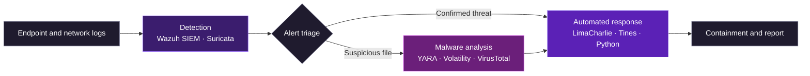

  

  Threat detection · Malware analysis · Security automation

  
  

---

## About

Cybersecurity engineer based in Tunis, Tunisia, focused on SOC analysis, threat detection and security automation. I build hands-on labs that cover the full detection and response cycle: collecting logs, detecting threats, analyzing malware and automating the response.

---

## Focus Areas

<table align="center">
  <tr>
    <td align="center" width="25%"><b>🔍 Threat Detection</b> SIEM rules, alerts, log analysis</td>
    <td align="center" width="25%"><b>🦠 Malware Analysis</b> Static and dynamic analysis, YARA</td>
    <td align="center" width="25%"><b>🧠 Forensics</b> Memory analysis with Volatility</td>
    <td align="center" width="25%"><b>⚡ Automation</b> SOAR playbooks, Python scripts</td>
  </tr>
</table>

---

## How My Lab Projects Fit Together

---

## Featured Projects

| Project | Description | Tech Stack |
| :--- | :--- | :--- |
| **[SOC Lab - Wazuh SIEM](https://github.com/imeneamami)** | Real-time threat detection and SIEM log analysis lab. |    |
| **[Malware Sandbox Environment](https://github.com/imeneamami)** | Automated environment configured for dynamic malware analysis. |    |
| **[SOAR and EDR Project](https://github.com/imeneamami)** | Automated security orchestration, response, and endpoint detection. |    |

---

## Tech Stack

| Area | Tools |
| :--- | :--- |
| **Threat Detection and SIEM** |   |
| **Malware Analysis and Forensics** |    |
| **Automation and SOAR** |    |
| **OS and Testing** |     |

---

## GitHub Stats

  
  

---

## Contact

  

  

